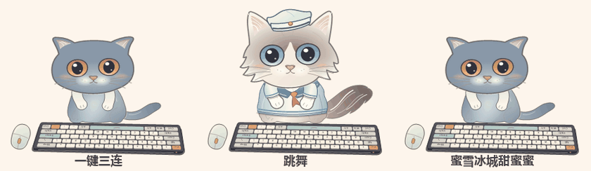
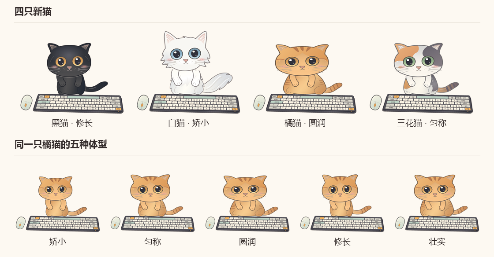

# 爪爪 PawPaw

一只陪你打字的桌面猫。你敲键盘，它跟着敲；连着输入 `fish`，它会抱起小鱼。停下来一会儿，它会洗脸、侧耳听动静，或者回头扑自己的尾巴。

**[下载 Windows 版](https://github.com/18861870889/pawpaw/releases/latest/download/PawPaw-Windows.exe)**　·　**[下载 macOS 通用版](https://github.com/18861870889/pawpaw/releases/latest/download/PawPaw-macOS-universal.zip)**　·　[所有版本与校验文件](https://github.com/18861870889/pawpaw/releases)　·　[English](README.en.md)

## 第一次打开

| 平台 | 安装与启动 |
| --- | --- |
| Windows | 双击 `PawPaw-Windows.exe`。猫咪出现在桌面右下角，设置在猫咪和托盘图标的右键菜单里。 |
| macOS 11 或更高版本 | 解压后将 `PawPaw.app` 拖入「应用程序」，双击打开。Apple 芯片和 Intel Mac 共用同一个包。跨应用打字需要为爪爪开启「输入监控」。 |

Mac 安装包采用本地签名，尚未经 Apple 公证。首次打开若遇到系统提示，请先核对下载来源，再按系统说明操作。[Apple 首次打开说明](https://support.apple.com/zh-cn/102445)

在普通输入框连续敲 `xiaoyu`，敲到最后一个 `u`，猫咪就会举起「小鱼」气泡抱鱼。之后选「小鱼」或「小雨」都可以。用双拼、五笔或粘贴输入「小鱼」也能抱鱼。同一次输入只演一次，再输入一次可以再演。英文口令 `fish` 和右键「单词彩蛋」也能点播这个动作。

## 和它玩

- **换猫和换装**　「装扮工作室」有十一只预设猫咪，包括黑猫、白猫、橘猫和三花猫。每只猫单独保存体型与穿搭，也可以新建角色，自选毛型、花色和瞳色。
- **调整体型**　右键「猫咪体型」，可选娇小、匀称、圆润、修长或壮实。工作室里的「体型」也能边看边选。「桌宠大小」单独控制整个窗口的缩放。
- **键鼠互动**　长按一个键，猫咪会皱眉连敲。Dota 2 里移动鼠标时它会用眼睛跟随，敲技能键时优先敲键帽。
- **彩蛋**　输入「一键三连」会看到猫蹲下、跳起来，朝屏幕连按三下。「跳舞」让它左右换步摆肩。「蜜雪冰城甜蜜蜜」或简拼 `mxbctmm` 会让它举起甜筒、用另一只爪画心。右键「单词彩蛋」可以点播全部十二个动作。
- **锁定与穿透**　右键选择「锁定桌宠（点击穿透）」。猫咪继续活动，点按、拖动和滚动会落到后面的软件上。点猫咪右上角的小锁恢复控制。重启后沿用锁定状态。
- **桌面摆放**　拖动猫咪改变位置，右键调整大小或透明度。找不到猫时，从系统托盘或菜单栏选「回到屏幕右下角」。

## 输入与隐私

彩蛋在本机匹配固定口令。在系统可识别的普通编辑框，爪爪只核对光标前最多八个字符，用来识别刚输入或粘贴的词。剪贴板内容和打字记录都不会保存或上传。Mac 可在「单词彩蛋 → 启用汉字词匹配」授权辅助功能。仅使用拼音时，「输入监控」权限就够了。系统标记为密码输入时，猫咪会捂眼并清除气泡和彩蛋。自绘控件能否识别为密码框，取决于应用和系统提供的标记。右键可随时「暂停键鼠互动」，也可以单独关闭按键气泡。

## 帮助和参与

- 打字没有反应、更新安装或想校验下载文件，请看[使用与排查](docs/help.md)。
- 从干净的仓库构建、离线准备画稿、运行测试和发布新版本，请看[开发指南](docs/development.md)。
- 新功能和版本变化见[更新记录](CHANGELOG.md)。遇到问题可从应用的「帮助与反馈」进入，也可以直接[提交反馈](https://github.com/18861870889/pawpaw/issues/new/choose)。
