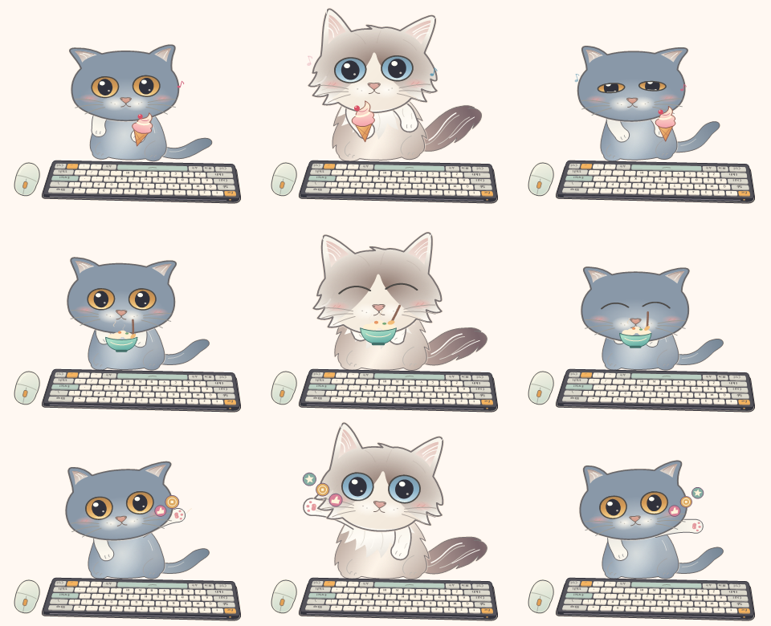

# 一个彩蛋占多少资源

以下为爪爪 2.1.0 的三个新增彩蛋。三个动作分别复用摇摆、抱鱼、挥爪的身体动画，短毛和长毛各有一套道具帧，同体型的品种和服装共用这些帧。

| 彩蛋 | Windows 程序增量 | Mac 道具图集 | Mac 图集压缩增量 | Mac 单帧道具像素峰值 |
| --- | ---: | ---: | ---: | ---: |
| 蜜雪冰城甜蜜蜜 | 2.0 KiB | 456.6 KiB | 438.7 KiB | 295.6 KiB |
| 干饭时间 | 1.5 KiB | 343.0 KiB | 336.6 KiB | 42.2 KiB |
| 一键三连 | 1.5 KiB | 107.9 KiB | 104.2 KiB | 51.5 KiB |

**Windows**　对每个彩蛋各做一次对照构建。在同一份发行源码中仅移除该动作的注册、口令和专属绘制代码，以相同编译参数生成 EXE，再比较字节数。PE 文件按块对齐，小改动的增量取决于当前程序的布局。

**Mac 磁盘**　从发行动画索引提取两个体型独占的 PNG 数据。压缩增量是对完整图集与剔除该动作后的图集分别做 DEFLATE 6 级压缩的大小差，范围只含图集数据。1 KiB 为 1024 字节。

**播放时**　Mac 单帧道具像素按裁切后的宽 × 高 × 4 字节计算。应用按需解码，所有纹理共用限额 48 MiB 的缓存，实际进程内存会随系统回收和正在使用的画稿浮动。Windows 在本机以 320 × 260、经典画风、默认英短做离屏重绘，每轮 96 帧，九轮取中位数。甜筒、干饭、三连每帧分别为 2.69、2.56、2.97 毫秒。它们与各自复用的原动作的配对差分别是 −0.03、−0.12、+0.06 毫秒。这些是绘制整只猫的耗时，桌面合成及其他设备的开销另计。

